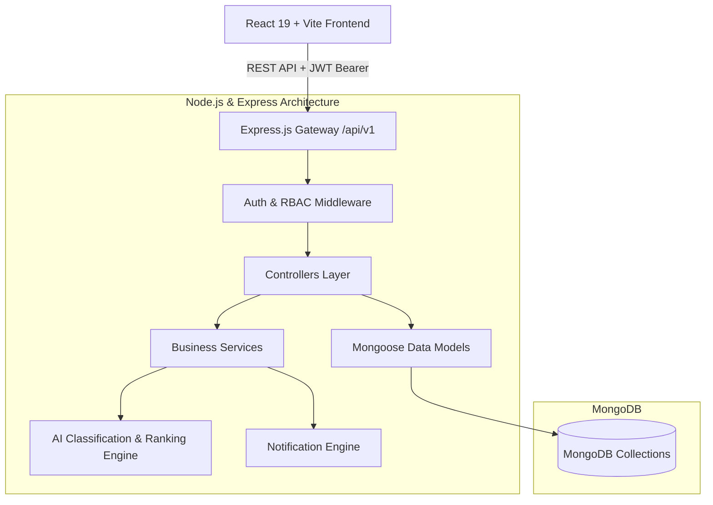

# 🛠️ CareConnect — Home Services Operations & Marketplace Platform

> **Capstone Project**: A full-stack MERN (MongoDB, Express, React, Node.js) home services marketplace and operations management platform featuring 5 role-based dashboards, AI-assisted request classification, provider matching, booking lifecycle tracking, invoicing, disputes, and analytics.

---

## 🌟 Executive Summary

**CareConnect** connects homeowners and clients with verified professional service providers (plumbers, electricians, cleaners, technicians) through an end-to-end workflow:

1. **Intelligent Service Request**: Customers post issues; built-in AI classifies the domain and extracts required skills.
2. **Provider Discovery & Quotes**: Verified providers receive matched requests and submit competitive quotes.
3. **Smart Scheduling & Booking**: Conflict-free availability slot engine prevents overlapping appointments.
4. **Job Execution & Evidence Tracking**: Real-time job status updates (`pending` → `en_route` → `started` → `completed`), work notes, before/after evidence photos, and customer sign-off.
5. **Billing & Invoices**: Itemized invoice generation with tax, platform fees, and status tracking.
6. **Accountability & Quality**: Rating and review system, dispute resolution workflows with audit logging.

---

## 🏛️ System Architecture



---

## 👥 Multi-Role Access Control (RBAC)

The platform implements 5 distinct personas with specialized permissions and views:

| Role | Core Responsibilities & Features |
| :--- | :--- |
| **Customer** | Post service requests, view AI-suggested providers, accept quotes, track live job status, upload confirmation, pay invoices, submit reviews, raise disputes, and chat with assigned providers. |
| **Provider** | Manage business profile, set weekly availability slots, browse matching requests, submit price quotes, update job status (`en_route`, `started`, `completed`), attach before/after photos, and issue invoices. |
| **Operations Manager** | Oversee platform operations, inspect live booking flows, reassign jobs, manage service categories, and analyze operational bottlenecks. |
| **Support Agent** | Investigate customer/provider disputes, review evidence, communicate with parties, and resolve disputes with resolution notes. |
| **Administrator** | Manage user accounts (activate/deactivate), review provider KYC verification documents, inspect audit trails, and view platform-wide financial & volume analytics. |

---

## 💻 Tech Stack

### **Frontend**
- **Framework:** React 19 (via Vite)
- **Routing:** React Router v7
- **Styling:** Tailwind CSS + Vanilla CSS Design System
- **Icons:** Lucide React
- **Visualizations:** Recharts (Analytics dashboards)
- **Maps:** Leaflet & React-Leaflet
- **HTTP Client:** Axios with JWT request interceptors

### **Backend**
- **Runtime:** Node.js 18+ & Express.js
- **Database:** MongoDB with Mongoose ODM
- **Authentication:** JWT (JSON Web Tokens) with `bcryptjs` password hashing
- **Security:** CORS configuration, input sanitization, error-handling middleware
- **Architecture:** Clean MVC (`Routes → Middleware → Controllers → Services → Models`)

---

## 📁 Repository Structure

```
careconnect/
├── README.md                 # Project Overview & Capstone Documentation (this file)
├── backend/                  # Express & MongoDB REST API
│   ├── README.md             # Backend API Documentation & Setup Guide
│   ├── server.js             # Server entry point
│   ├── package.json          # Backend dependencies and scripts
│   ├── seed/                 # Database seeder with realistic test data
│   ├── test/                 # Automated Node.js test suite
│   └── src/
│       ├── config/           # Database connection config
│       ├── controllers/      # Request handlers
│       ├── middleware/       # Auth, role authorization, and error handling
│       ├── models/           # Mongoose schemas (14 collections)
│       ├── routes/           # REST endpoints
│       ├── services/         # AI classifier, ranking, notifications
│       └── utils/            # AppError, catchAsync, token helpers
└── frontend/                 # React + Vite Single Page Application
    ├── README.md             # Frontend Architecture & Setup Guide
    ├── package.json          # Frontend dependencies
    ├── vite.config.js        # Vite configuration
    ├── vercel.json           # Vercel SPA rewrite rules
    ├── public/
    │   └── _redirects        # Netlify SPA routing fallback
    └── src/
        ├── api.js            # Axios client with bearer token injection
        ├── App.jsx           # Master route table & role gates
        ├── components/       # Reusable UI components (Navbar, Layout, ProtectedRoute)
        ├── context/          # Auth state provider
        ├── pages/            # 22 role-specific screens & dashboards
        └── utils/            # Role normalizers and helper functions
```

---

## ⚡ Quick Start (Local Development)

### **Prerequisites**
- Node.js 18+ installed
- MongoDB running locally OR a free MongoDB Atlas connection URI

### **1. Setup Backend**
```bash
cd backend

# Install dependencies
npm install

# Configure environment
cp .env.example .env
# Open .env and set your MONGO_URI and JWT_SECRET

# Populate database with demo accounts, categories, and sample data
npm run seed

# Start backend dev server (Runs on port 5000)
npm run dev
```

### **2. Setup Frontend**
```bash
# In a separate terminal
cd frontend

# Install dependencies
npm install

# Start Vite dev server (Runs on http://localhost:5173)
npm run dev
```

Visit **`http://localhost:5173`** to access the platform.

---

## 🔑 Demo Test Accounts

The seed script (`npm run seed` in backend) creates realistic accounts for all platform roles.

| Role | Email | Password | Primary Feature to Test |
| :--- | :--- | :--- | :--- |
| **Customer** | `customer1@demo.com` | `password123` | Post request, view quotes, track job |
| **Provider (Verified)** | `provider1@demo.com` | `password123` | Manage calendar slots, submit quotes, upload job evidence |
| **Provider (Pending)** | `provider2@demo.com` | `password123` | View pending verification state |
| **Operations Manager**| `ops@demo.com` | `password123` | Operational dashboard, category manager |
| **Support Agent** | `support@demo.com` | `password123` | Dispute resolution queue |
| **Admin** | `admin@demo.com` | `password123` | Platform analytics, user activation, audit logs |

---

## 🚀 Deployment Guide

Detailed deployment instructions for free cloud providers:

1. **Database:** Deploy a free M0 Cluster on [MongoDB Atlas](https://www.mongodb.com/cloud/atlas).
2. **Backend:** Deploy on [Render](https://render.com) or [Railway](https://railway.app) as a Web Service. Set root directory to `backend`, build command `npm install`, start command `npm start`.
3. **Frontend:** Deploy on [Vercel](https://vercel.com) or [Netlify](https://netlify.com). Set root directory to `frontend`, build command `npm run build`, output directory `dist`. Add `VITE_API_URL` pointing to your deployed backend API URL.

---

## 🧪 Testing & Validation

```bash
# Run backend service unit tests
cd backend
npm test

# Verify frontend production build
cd frontend
npm run build
```

---

## 📄 License & Attribution
Developed as an academic capstone project demonstrating modern full-stack web engineering, scalable role-based architecture, and clean code practices.
