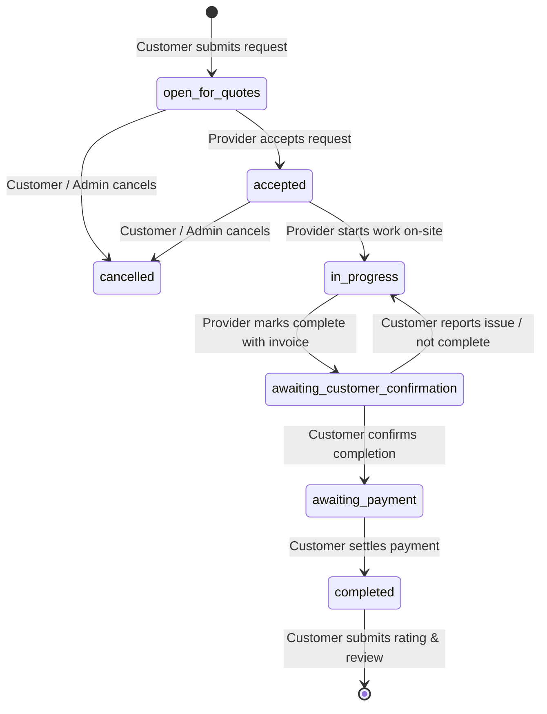

# CareConnect — Home Services & Care Platform

CareConnect is an end-to-end service coordination platform connecting customers with verified local service professionals (plumbers, electricians, carpenters, cleaners) featuring transparent job verification, digital payments, dispute handling, provider geo-mapping, and administrative oversight.

---

## Architecture Overview

```
careconnect/
├── backend/                  # Express REST API & MongoDB database layer
│   ├── src/
│   │   ├── config/           # MongoDB connection & index safeguards (db.js)
│   │   ├── controllers/      # Business logic (auth, serviceRequest, admin, workspace, dashboard)
│   │   ├── middleware/       # JWT authentication, role authorization & error handling
│   │   ├── models/           # Mongoose schemas (User)
│   │   ├── routes/           # REST endpoints (/api/auth, /api/service-requests, /api/admin, etc.)
│   │   └── utils/            # JWT token generation
│   ├── seed/                 # Database seeder (seedData.js)
│   ├── test/                 # Test suite (node:test)
│   ├── server.js             # API entrypoint (Port 5000)
│   └── .env.example          # Environment configuration template
├── frontend/                 # Workspace client (HTML, CSS, Vanilla JS)
│   ├── app.js                # Dynamic workspace router, state management & Leaflet map
│   ├── styles.css            # Clean, responsive design system
│   ├── index.html            # Web entry point
│   └── server.js             # Static file server & API reverse-proxy (Port 5175)
└── package.json              # Unified root development scripts
```

---

## Complete Service Workflow Lifecycle



1. **Submit Request**: Customer specifies service details, category, city, urgency, and preferred date (`open_for_quotes`).
2. **Provider Assignment**: Verified providers view available tasks and accept (`accepted`).
3. **Work In Progress**: Provider marks "Start Service" upon arriving on-site (`in_progress`).
4. **Completion & Invoicing**: Provider finishes work and submits agreed total amount (`awaiting_customer_confirmation`). A pending invoice is created.
5. **Customer Verification**:
   - **Confirm**: Customer verifies satisfactory completion & activates payment step (`awaiting_payment`).
   - **Dispute / Reject**: Customer reports work not done; reverts to `in_progress` with feedback note to the provider.
6. **Payment Settlement**: Customer pays via Card, Cash, UPI, or Bank Transfer. Invoice updates to `paid` and funds register in provider earnings (`completed`).
7. **Rate & Review**: Customer submits 1–5 star rating and feedback, dynamically recalculating the provider's overall score.

---

## Quick Start Guide

### Prerequisites
- [Node.js](https://nodejs.org/) (v18 or higher)
- [MongoDB](https://www.mongodb.com/) running locally (`mongodb://127.0.0.1:27017`) or a MongoDB Atlas URI

### 1. Installation
Clone the repository and install dependencies:
```bash
# Install backend dependencies
cd backend
npm install
cd ..

# Install frontend dependencies (if needed)
cd frontend
npm install
cd ..
```

### 2. Environment Setup
Copy the environment template in the `backend/` folder:
```bash
copy backend\.env.example backend\.env
```
Ensure your `backend/.env` file contains:
```env
PORT=5000
NODE_ENV=development
MONGO_URI=mongodb://127.0.0.1:27017/careconnect
JWT_SECRET=careconnect-local-dev-signing-key-change-before-production-2026
JWT_EXPIRES_IN=7d
```

### 3. Seed Demo Data
Populate the database with pre-configured users, provider profiles with GPS coordinates, active service requests in each stage, invoices, and notifications:
```bash
npm run seed
```

### 4. Run the Application
Start the backend and frontend dev servers (open two terminal windows or run root commands):

```bash
# Terminal 1 — Start API Backend (runs on http://localhost:5000)
npm run backend

# Terminal 2 — Start Frontend Workspace (runs on http://localhost:5175)
npm run frontend
```

Now open [http://localhost:5175](http://localhost:5175) in your web browser.

---

## Deploy the Frontend to Vercel

Create a Vercel project for this repository with these settings:

| Setting | Value |
| :--- | :--- |
| Root Directory | `frontend` |
| Framework Preset | `Other` |
| Build Command | `npm run build` |
| Output Directory | `dist` |

The build copies the static app entry point and its assets into `frontend/dist`. Do not use the `Node` or `Vite` preset for this frontend: its deployed entry point is `frontend/index.html`, not the unused React/Vite source under `frontend/src`.

The frontend calls the API at `/api`, which works locally through `frontend/server.js`. A Vercel static deployment does not run that local proxy or the backend. Deploy the backend separately and configure a Vercel rewrite from `/api/*` to the deployed backend URL; configure the backend to allow requests from the Vercel site.

---

## Demo Accounts

You can click any of the **Quick Demo Logins** on the sign-in page, or log in with these credentials:

| Role | Email | Password | What You Can Test |
| :--- | :--- | :--- | :--- |
| **Administrator** | `admin@careconnect.lk` | `Admin@123` | Provider management, platform-wide revenue, cancel requests |
| **Customer** | `anoma.wijesinghe@careconnect.lk` | `Pass@123` | Create requests, verify completed work, pay invoices, submit reviews |
| **Service Provider** | `kamal.perera@careconnect.lk` | `Pass@123` | Accept requests, start jobs, mark work complete with billing |

---

## Testing

Run the automated test suite using the built-in Node test runner:
```bash
npm test
```
All tests validate request state transitions, provider invoice limits, customer cancellation permissions, and review submissions.

---

## API Summary

| Method | Endpoint | Role | Description |
| :--- | :--- | :--- | :--- |
| `GET` | `/api/health` | Public | System status and uptime |
| `POST` | `/api/auth/register` | Public | Register customer/provider (auto-creates profile) |
| `POST` | `/api/auth/login` | Public | Authenticate user & receive JWT |
| `GET` | `/api/service-requests` | Authenticated | List service requests with role scoping |
| `POST` | `/api/service-requests` | Customer | Create a new service request |
| `POST` | `/api/service-requests/:id/accept` | Provider | Accept an open service request |
| `POST` | `/api/service-requests/:id/start` | Provider | Start work on accepted request |
| `POST` | `/api/service-requests/:id/complete` | Provider | Mark work complete & generate invoice |
| `POST` | `/api/service-requests/:id/confirm` | Customer | Confirm task completion |
| `POST` | `/api/service-requests/:id/reject-completion` | Customer | Dispute / report task incomplete |
| `POST` | `/api/service-requests/:id/pay` | Customer | Settle invoice with payment method |
| `POST` | `/api/service-requests/:id/review` | Customer | Rate and review completed service |
| `POST` | `/api/service-requests/:id/cancel` | Customer / Admin | Cancel open or accepted request |
| `GET` | `/api/map/providers` | Authenticated | List verified providers with GPS coordinates |
| `GET` | `/api/payments` | Authenticated | View invoice history & revenue summaries |
| `GET` | `/api/admin/providers` | Admin | List all providers with individual stats |
| `POST` | `/api/admin/providers` | Admin | Manually provision new provider account |
